<p align="center">
  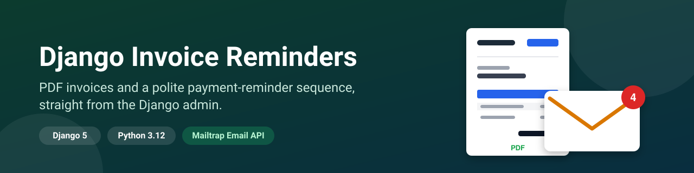
</p>

# PDF Invoices and Automatic Payment Reminders in Django (Mailtrap)

A small Django app for getting paid on time: add an invoice in a simple dashboard, email it to your client as a PDF, and let a polite reminder sequence follow up before and after the due date until you mark it paid. Built with Django 5 and Python 3.12, with every email and attachment delivered through the Mailtrap Email API Transactional stream.

<p>
  
  
  
  
  
  
</p>

## The problem

Late payments rarely come from clients who refuse to pay. They come from invoices that get buried, and from the awkwardness of chasing money. So freelancers and small teams either nag by hand, which is slow and uncomfortable, or forget to follow up at all. Automating it is easy to get wrong: the same reminder goes out twice, a client in another time zone gets an email at 3 a.m., a burst of five emails arrives after the scheduler was down, or reminders keep coming after the invoice was paid.

## What this repo solves

A small, complete Django app that sends the invoice and then runs the follow-up for you, ready to read, run and adapt.

| Problem | How this repo handles it |
| --- | --- |
| Invoices are slow to create and send | One form: name, amount, due date and the client's email. It saves, renders a PDF and emails it. |
| Forgetting to follow up | A four-step sequence: 3 days before the due date, on the day, 7 days overdue and a final notice at 14 days |
| The same reminder sent twice | A unique `(invoice, stage)` row is claimed before each send, so even overlapping runs send once |
| A burst of reminders after a missed run | Only the latest due stage is sent. Earlier ones are recorded as skipped. |
| Emails at the wrong time for the client | "Today" and the 09:00–18:00 send window follow each client's own time zone |
| Reminders after the client has paid | **Mark paid** stops everything and sends a receipt. Bounced or spam-flagged addresses are skipped too. |
| Losing track of who owes what | A tracking table with status, days overdue, the reminders already sent and the next one due |

**Contents:** [Demo](#demo) · [How it works](#how-it-works) · [Features](#features) · [Stack](#stack) · [Prerequisites](#prerequisites) · [Mailtrap setup](#mailtrap-setup) · [Quick start](#quick-start) · [Screenshots](#screenshots) · [Using the dashboard](#using-the-dashboard) · [Using the admin](#using-the-admin) · [Reminder rules](#reminder-rules) · [Key integration points](#key-integration-points) · [Failure behavior](#failure-behavior) · [Security design](#security-design) · [Configuration](#configuration) · [Webhook](#webhook) · [Scheduling](#scheduling) · [Time zones](#time-zones) · [Data model](#data-model) · [Project structure](#project-structure) · [Tests](#tests) · [Deploying](#deploying-to-production) · [Limitations](#limitations) · [FAQ](#faq) · [Contributing](#contributing)

## Demo

<p align="center">
  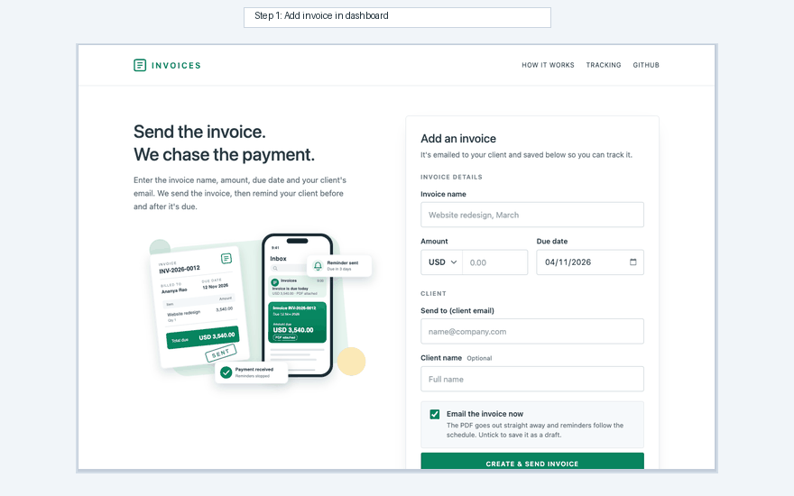
</p>

Creating an invoice and following up automatically: fill in the dashboard form, email the client with an A4 PDF attached, monitor due dates on the live tracking table, and let the scheduled command send heads-up, due-today, and overdue reminders until payment is marked. Recorded from a local run of this code.

## How it works

The app is a single Django project. You add and manage invoices in a dashboard, a management command that runs every hour sends the reminders (each in the client's own time zone and working hours), and Mailtrap delivers every email. Everything is stored in one SQLite database.

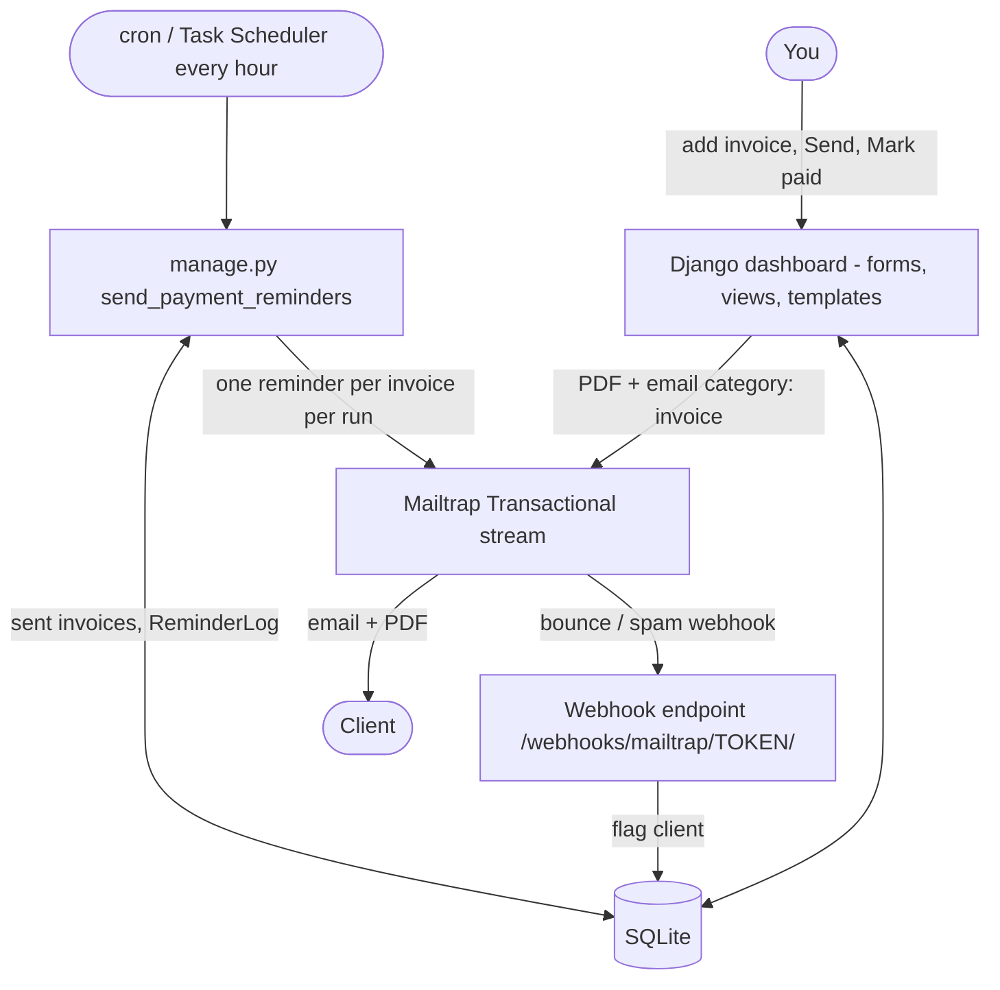

| Part | What it does | Where |
| --- | --- | --- |
| Settings | `.env` loading with a stdlib loader, fail-fast checks, reminder stages | `config/settings.py`, `config/env.py` |
| Dashboard | The invoice form, the tracking table, and the send, resend, paid and void actions | `invoices/ui.py`, `invoices/forms.py`, `templates/app/` |
| Models | `Client`, `Invoice`, `LineItem`, `ReminderLog`, `WebhookEvent` | `invoices/models.py` |
| Admin | Optional back office: inlines, badges, actions, PDF preview | `invoices/admin.py` |
| PDF | A4 invoice with fpdf2 and the bundled DejaVu Sans font | `invoices/services/pdf.py` |
| Invoicing | Send, resend, mark paid, void, and email rendering | `invoices/services/invoicing.py` |
| Reminders | A pure stage planner plus claim-then-send execution | `invoices/services/reminders.py` |
| Mailer | `Mailer` protocol, `MailtrapMailer`, and `FakeMailer` for tests | `invoices/services/email.py` |
| Webhook | Token check, optional signature check, idempotent event processing | `invoices/views.py`, `invoices/services/webhooks.py` |
| Commands | `send_payment_reminders`, `seed_demo` | `invoices/management/commands/` |
| Templates | Plain text and inline-styled HTML for each email | `templates/emails/` |

### Invoice to paid

You add the invoice in the dashboard, and the app saves it, renders the PDF and emails it. After that, an hourly command takes over to deliver follow-up reminders in each client's own time zone.

<p align="center">
  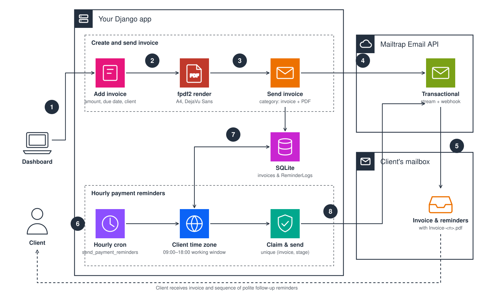
</p>

1. You fill in the dashboard form (`POST /invoices/new/`): name, amount, due date and the client's email.
2. The app validates it, finds or creates the client by email and saves the invoice with one line item and an auto-number such as `INV-2026-0001`.
3. With **Email the invoice now** ticked, it renders the A4 PDF with fpdf2.
4. It sends the email with the PDF attached through the Mailtrap Transactional stream and marks the invoice as sent. If Mailtrap rejects it, the invoice stays a draft.
5. Mailtrap delivers the email to the client's inbox.
6. An hourly scheduler runs `send_payment_reminders`.
7. For each sent invoice it plans the stage in the client's own time zone: only the latest due stage, only inside the send window, never on the day it was sent.
8. It claims the stage by inserting a `pending` row that the unique `(invoice, stage)` constraint guards, then sends the reminder with the PDF attached.
9. The row becomes `sent` with Mailtrap's `message_id`, or `failed` with the error, which is retried on the next run.

### One reminder run, step by step

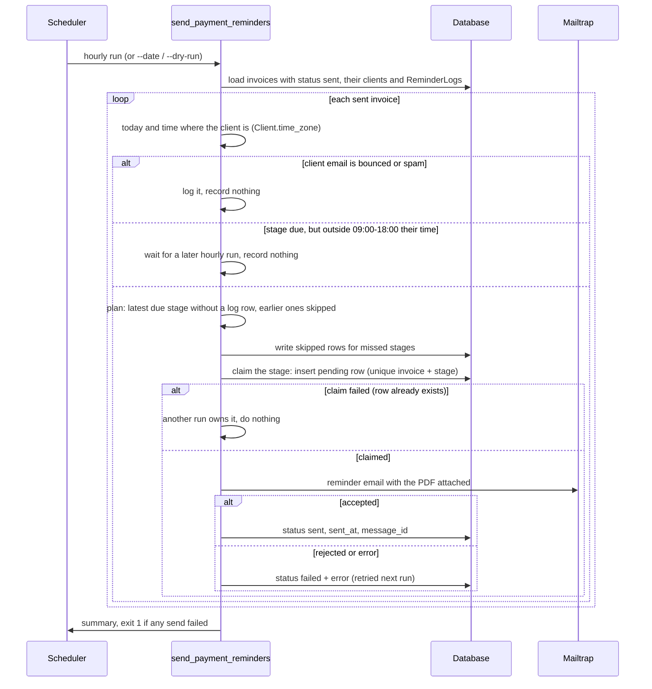

## Features

- **A simple dashboard.** Add an invoice with five fields, then see every invoice in a tracking table with filter tabs, status, days overdue, reminders sent and the next one due. No login screen to get in your way, see [Security design](#security-design).
- **Invoices with PDFs.** Auto-numbering (`INV-2026-0001`, per issue year), currencies USD (default), EUR, GBP, AUD, CAD, SGD, AED and INR, and amounts shown as `USD 1,200.00`. Optional tax and extra line items are available in the admin.
- **PDF invoices.** A4, rendered with fpdf2 in pure Python, so there are no system libraries to install, including on Windows. The bundled DejaVu Sans font renders names like *Zoë Ångström* and symbols like ☕ and ✓. Files are named `Invoice-<number>.pdf`. Paid invoices get a green **PAID** label.
- **One-click sending.** Save and email in one step, or save as a draft and use **Send** later. If Mailtrap rejects the email, the invoice stays a draft and the error is shown.
- **A four-step reminder sequence.** Heads-up 3 days before the due date, due today, 7 days overdue, and a final notice at 14 days. Each stage has its own subject, plain-text and HTML template, Mailtrap category and colour, and re-attaches the PDF. Change the stages in `settings.REMINDER_STAGES`.
- **Never the same reminder twice.** A unique constraint on `(invoice, stage)` and a claim-before-send pattern guarantee it, even if two runs overlap.
- **No bursts after missed runs.** If the scheduler didn't run for a week, the client gets only the most relevant reminder. The earlier ones are recorded as skipped.
- **Mark as paid.** Stops all future reminders and sends a payment receipt.
- **Bounce and spam protection.** A Mailtrap webhook flags clients whose address hard-bounces or who report spam. Their reminders stop.
- **Every client in their own time zone.** "Due today" means today *where the client is*, and reminders arrive during their working hours (09:00–18:00 by default), never in the middle of their night.
- **Dry run and date override.** `--dry-run` shows what would be sent and writes nothing. `--date` simulates any day.
- **Minimal client-facing content.** Only your business name appears: no address, no email addresses, no bank details, no internal notes.
- **Polished emails and UI.**
  - gradient-card emails with the amount, due date and a PDF tag, plus a plain-text version
  - a responsive dashboard with a live tracking table and filter tabs
  - keyboard focus styles and reduced-motion support
  - works without a JavaScript framework
- **Fully tested without a network.** 115 tests run against a fake mailer that builds the real Mailtrap SDK payload.

## Stack

| | |
| --- | --- |
| Language | Python 3.12 |
| Web framework and UI | Django 5.2: a server-rendered dashboard (inline CSS, no build step) and the Django admin |
| Database | SQLite |
| PDF | [fpdf2](https://py-pdf.github.io/fpdf2/) with the bundled [DejaVu Sans](https://dejavu-fonts.github.io/) font |
| Email | [`mailtrap`](https://github.com/railsware/mailtrap-python) Python SDK, Transactional stream |
| Tests | pytest + pytest-django |

The only runtime dependencies are `django`, `fpdf2` and `mailtrap`; the dev dependencies are `pytest` and `pytest-django`. All versions are pinned in `requirements.txt` and `requirements-dev.txt`. There is no Celery, no DRF, no frontend framework and no python-dotenv. A small stdlib loader reads `.env`.

## Prerequisites

- Python 3.12.
- A [Mailtrap](https://mailtrap.io) account. The free plan is enough to try it out.
- Something that can run a command every hour: cron on Linux or macOS, Task Scheduler on Windows, or any server scheduler.

## Mailtrap setup

1. **Create an API token.** In Mailtrap, go to **Settings → API Tokens** and create a token with sending access to your domain. Put it in `.env` as `MAILTRAP_API_TOKEN`.
2. **Try it on the demo domain first.** New accounts get a demo sending domain, `demomailtrap.co`. Set `MAIL_FROM_EMAIL=billing@demomailtrap.co` and use **the email address you signed up to Mailtrap with** as the client email. Things to know:
   - The demo domain only delivers to the Mailtrap account owner. Sending to anyone else fails with `403: Demo domains can only be used to send emails to account owners`. If you get this error, check which Mailtrap account your token belongs to: a token from a colleague's account can only send to *their* address.
   - The demo domain has a small sending allowance. Once it's used up, every send fails with `403: Sending usage of this domain has reached its limit`.
   - Mail from a shared demo domain can land in spam, so check there for the first email.
3. **Verify your own domain to email real clients.** Go to **Sending Domains → Add domain** and create the DNS records Mailtrap shows (SPF, DKIM, DMARC). When the domain shows as verified, set `MAIL_FROM_EMAIL` to an address on it.
4. **Add the webhook.** This is optional but recommended once you send to real clients. See [Webhook](#webhook).
5. **Know your plan's limits.** See [Mailtrap sending limits](https://docs.mailtrap.io/email-api-smtp/setup/sending-limits).

## Quick start

```bash
git clone https://github.com/manishgupta412/django-invoice-reminders.git && cd django-invoice-reminders
python3.12 -m venv .venv
source .venv/bin/activate              # Windows: .venv\Scripts\activate
pip install -r requirements-dev.txt    # requirements.txt for production

cp .env.example .env                   # then fill it in (see Configuration)
python manage.py migrate

# Demo data: 4 sent invoices due in 3 days, due today, 7 and 14 days overdue
python manage.py seed_demo --email you@yourdomain.com

python manage.py send_payment_reminders --dry-run   # see what would be sent
python manage.py send_payment_reminders             # send it: 4 emails, one per stage

python manage.py runserver             # http://localhost:8000/
```

Open http://localhost:8000/ for the dashboard. It needs no account. To also use the Django admin at `/admin/`, run `python manage.py createsuperuser`.

`seed_demo` is idempotent: running it again creates nothing new. To start the demo over (and delete its reminder history), run `python manage.py seed_demo --email you@yourdomain.com --reset`.

| Demo invoice | Due | Amount | First run sends |
| --- | --- | --- | --- |
| `DEMO-0001` | in 3 days | USD 1,200.00 | heads-up |
| `DEMO-0002` | today | EUR 2,250.00 | due today |
| `DEMO-0003` | 7 days ago | USD 570.00 | overdue |
| `DEMO-0004` | 14 days ago | EUR 640.00 | final notice |

### What you'll see in the terminal

The commands print clear, formatted status output. Sensitive secrets and API tokens never appear in terminal output or logs.

**Server started**

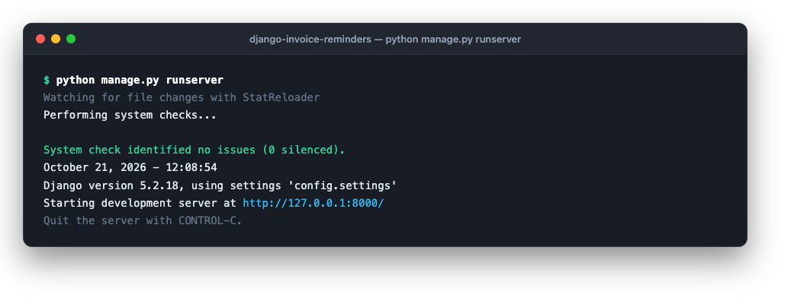

**Demo data seeded:** four sample invoices created spanning due in 3 days, due today, 7 days overdue, and 14 days overdue.

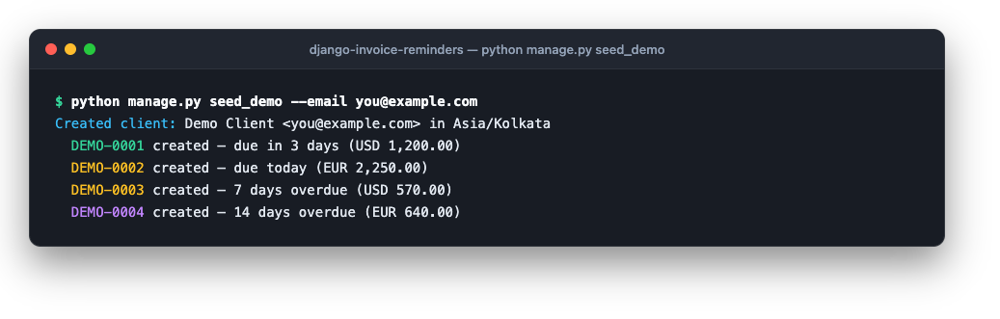

**Sending payment reminders:** the dry run previews what is due, the real run sends the appropriate stages, and a subsequent run sends nothing.

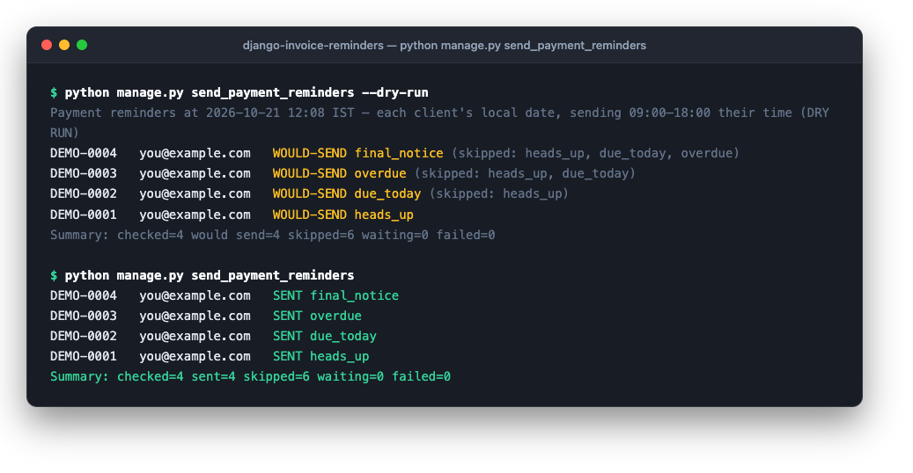

**Handling bounce and spam webhooks:** Mailtrap reports a bounce, the client is flagged, and duplicate events are recognized idempotently.

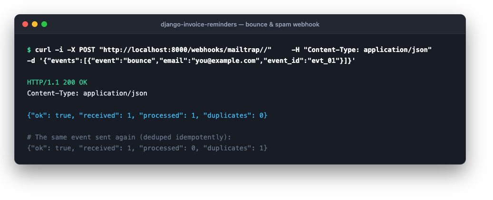

## Screenshots

<p align="center">
  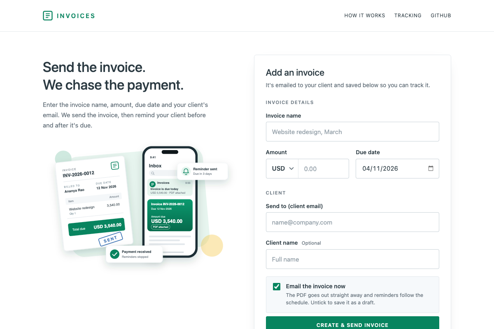
  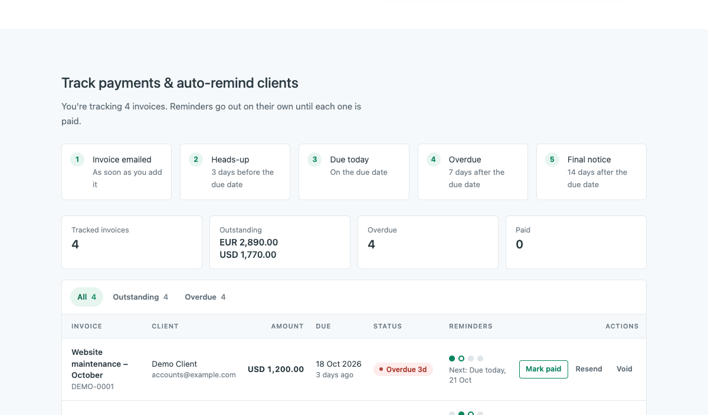
</p>
<p align="center">Create invoices in seconds with one form, and track payment stages on the live dashboard table.</p>

<p align="center">
  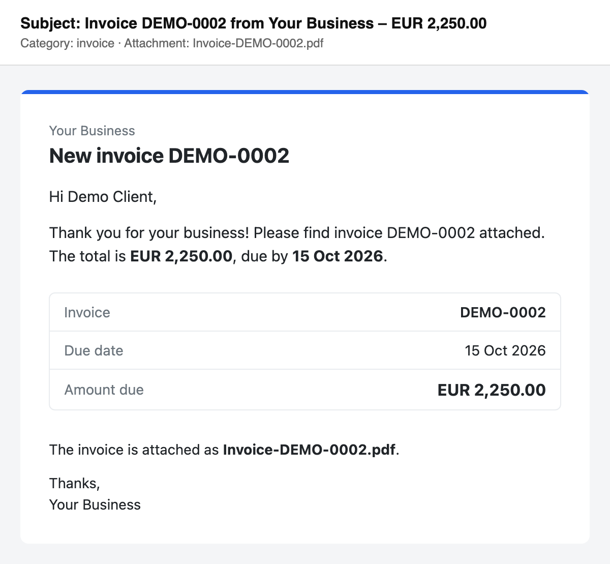
  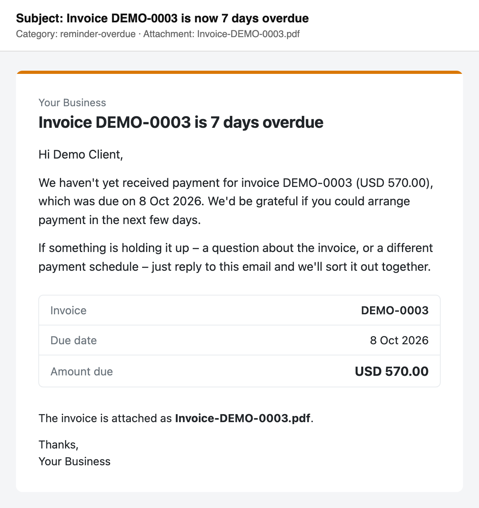
</p>
<p align="center">The invoice email and an overdue reminder. Each one attaches <code>Invoice-&lt;number&gt;.pdf</code>.</p>

<p align="center">
  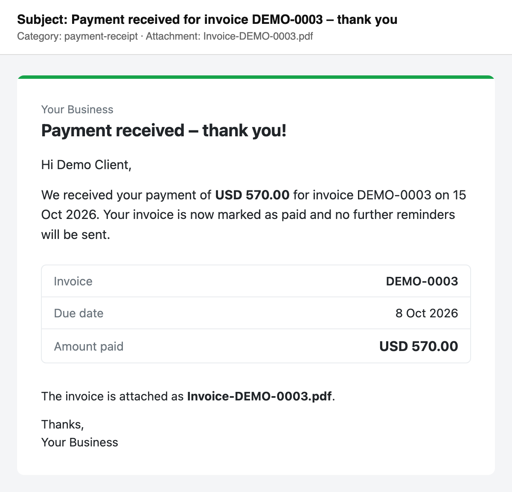
  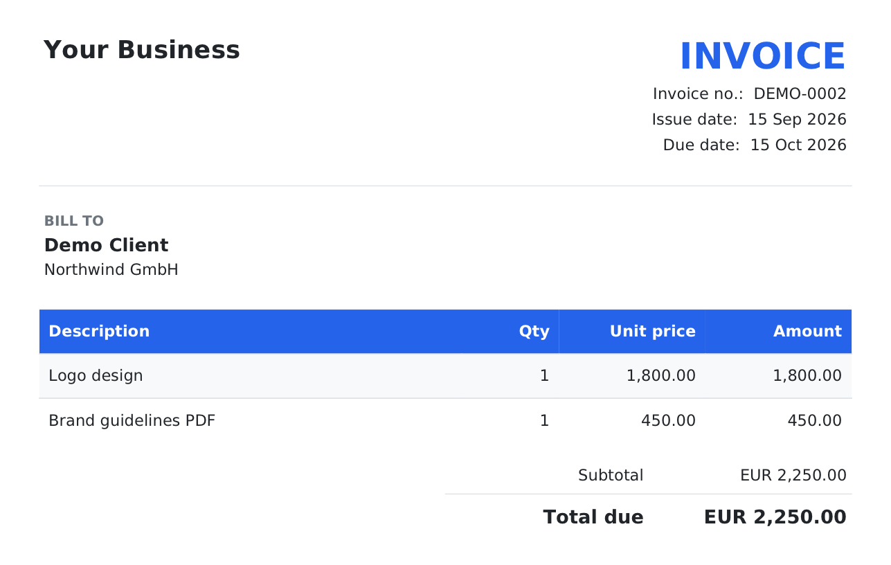
</p>
<p align="center">The payment receipt after <b>Mark paid</b>, and the A4 invoice PDF.</p>

The email and PDF screenshots are the real templates rendered with the demo data from `seed_demo`. The strip at the top of each email screenshot shows the subject, the Mailtrap category and the attachment name; it isn't part of the email. The heads-up, due-today and final-notice reminders use the same layout as the overdue one. Every email also has a plain-text version.

## Using the dashboard

Open `http://localhost:8000/`. The page has the form at the top, the reminder schedule, and the tracking table below.

**The form**

| Field | Notes |
| --- | --- |
| Invoice name | Becomes the invoice's single line item (up to 500 characters) |
| Amount | Greater than zero, two decimals, in the chosen currency (USD, EUR, GBP, AUD, CAD, SGD, AED or INR) |
| Due date | Today or later. It defaults to 14 days from now. |
| Send to | The client's email. An existing client with the same address (any capitalisation) is reused, otherwise one is created. |
| Client name | Optional. If left empty, the name is built from the email, so `sam.lee@…` becomes "Sam Lee". |
| Email the invoice now | On by default. Off saves the invoice as a draft, and you can **Send** it later. |

Invoices made here have one line item and no tax. Use the admin for several items or a tax rate.

**The tracking table**

- **Tabs.** All, Outstanding (sent and overdue), Overdue, Paid and Drafts, each with a count. Filtering happens in the browser.
- **Status.** Draft, Sent, **Overdue 7d**, Paid or Void, plus a relative due date such as "in 3 days" or "7 days ago".
- **Reminders.** One dot per stage: green is sent, a ring is the next one, red is failed and grey is not yet or skipped. Under the dots is the next stage and its date.
- **Actions.**

| Button | Shown for | What it does |
| --- | --- | --- |
| **Send** | draft | Renders the PDF, emails it and marks the invoice as sent |
| **Mark paid** | sent | Marks it paid, emails a receipt and stops all reminders. It asks you to confirm. |
| **Resend** | sent | Emails the invoice again. Status doesn't change. |
| **Void** | draft, sent | Marks it void, sends no email and stops reminders. It asks you to confirm. |

Every message, such as "INV-2026-0001 saved and emailed to …", appears as a banner at the top of the page.

## Using the admin

The admin is optional and lives at `http://localhost:8000/admin/`. Create an account with `python manage.py createsuperuser`.

- **Clients.** The list shows the name, company, email, **time zone**, the client's **current local time**, and email status. Pick the time zone from a dropdown of every IANA zone when you add a client; it defaults to your `TIME_ZONE`. Bounced clients get a red badge and spam complaints an orange one, with the date they were flagged. You can filter by status. The **Clear email flag** action lets reminders resume after you fix an address.
- **Invoices.** The list shows the number, client, total with currency, due date, status, days overdue, last reminder, and **Preview · Download** PDF links. You can filter by status, due date and currency, and search by number or client. The edit page has a line-item inline, read-only totals and a read-only **reminder history**. Status is read-only and changes only through the actions:

| Action | Allowed from | What it does |
| --- | --- | --- |
| **Send invoice** | draft | Renders the PDF, emails it (category `invoice`), and sets status to sent with `sent_at`. On failure, the invoice stays a draft and the error is shown. The invoice must have line items. |
| **Resend invoice** | sent | Emails the invoice again. Status and `sent_at` don't change. |
| **Mark as paid** | sent | Sets status to paid with `paid_at`, then sends the receipt (category `payment-receipt`). All reminders stop. |
| **Void invoice** | draft, sent | Sets status to void. No email. Reminders stop. |

Each action shows success and failure counts using Django messages.

The **Notes** field on an invoice is internal: it never appears in emails or PDFs. **Reminder logs** and **Webhook events** have their own read-only admin pages for auditing.

## Reminder rules

Default stages, set in `REMINDER_STAGES` in [`config/settings.py`](config/settings.py):

| Stage | When (vs due date) | Category | Subject | Tone |
| --- | --- | --- | --- | --- |
| `heads_up` | 3 days before | `reminder-heads-up` | `Coming up: invoice INV-2026-0001 is due on 18 Oct 2026` | friendly "coming up" |
| `due_today` | on the day | `reminder-due-today` | `Invoice INV-2026-0001 is due today` | polite |
| `overdue` | 7 days after | `reminder-overdue` | `Invoice INV-2026-0001 is now 7 days overdue` | firm but kind |
| `final_notice` | 14 days after | `reminder-final` | `Final notice: invoice INV-2026-0001 (USD 1,200.00) is overdue` | clear next steps |

The other emails:

| Email | Category | Subject |
| --- | --- | --- |
| Invoice (send and resend) | `invoice` | `Invoice INV-2026-0001 from <BUSINESS_NAME> – USD 1,200.00` |
| Payment receipt | `payment-receipt` | `Payment received for invoice INV-2026-0001 – thank you` |

How a run decides what to send. The planner is a pure function, `plan_stages()` in [`invoices/services/reminders.py`](invoices/services/reminders.py):

1. **Only sent invoices.** Only invoices with status `sent` are considered. Draft, paid and void invoices never get reminders.
2. **The client's own date and hours.** "Today" is the date in the client's time zone. If a stage is due but it's outside `REMINDER_SEND_HOURS` there (default `9-18`), the run waits and a later hourly run sends it. See [Time zones](#time-zones).
3. **Flagged clients are skipped.** If the client's email is `bounced` or `spam`, the invoice is logged and skipped, and nothing is recorded. Reminders resume once you clear the flag.
4. **Only the latest due stage is sent.** A stage is due when `due_date + offset` is on or before today and it has no `ReminderLog` row (or a `failed` one). Of the due stages, only the **latest** is sent. Earlier ones are recorded as `skipped`, so a client never gets a burst.
5. **Nothing on the day the invoice was sent.** A stage dated on or before the day the invoice was emailed (in the client's time zone) is recorded as `skipped`, because the invoice email already covered it.
6. **Claim, then send.** The run first inserts a `pending` row, which the unique `(invoice, stage)` constraint guards, and only then calls Mailtrap. The row becomes `sent` (with Mailtrap's `message_id`) or `failed` (with the error).

Example: an invoice due on 10 March and sent on 8 February.

| Run date | Sends |
| --- | --- |
| 7 Mar | `heads_up` |
| 10 Mar | `due_today` |
| 17 Mar | `overdue` |
| 24 Mar | `final_notice` |
| any other day | nothing |

Each date is the client's local date, and each email goes out at the first hourly run after 09:00 their time.

If the invoice is marked paid or voided at any point, nothing more is sent.

## Key integration points

**One email, one stream, one category.** The client is created without `bulk` or `sandbox`, so the SDK sends to the Transactional stream. The PDF is attached base64-encoded with an explicit MIME type and disposition, which is what makes it preview correctly in Gmail and Apple Mail ([`invoices/services/email.py`](invoices/services/email.py)):

```python
import base64
import mailtrap as mt

client = mt.MailtrapClient(token=settings.MAILTRAP_API_TOKEN)

client.send(mt.Mail(
    sender=mt.Address(email=settings.MAIL_FROM_EMAIL, name=settings.MAIL_FROM_NAME),
    to=[mt.Address(email=client_email, name=client_name)],
    subject=subject,
    text=text,
    html=html,
    category="reminder-overdue",  # invoice, reminder-*, payment-receipt
    attachments=[mt.Attachment(
        content=base64.b64encode(pdf_bytes),
        filename=f"Invoice-{invoice.number}.pdf",
        disposition=mt.Disposition.ATTACHMENT,
        mimetype="application/pdf",
    )],
))
```

**Claim the stage before sending.** The unique constraint is the lock. If the insert fails, another run already owns this stage, so this run skips it ([`invoices/services/reminders.py`](invoices/services/reminders.py)):

```python
try:
    with transaction.atomic():
        log = ReminderLog.objects.create(
            invoice=invoice, stage=stage.key, status=ReminderLog.Status.PENDING,
            scheduled_for=stage.date_for(invoice.due_date),
        )
except IntegrityError:
    return None  # already claimed: never send twice
```

**Retry failed sends on the same row.** A conditional `UPDATE` flips `failed` to `pending`, so only one concurrent run can retry it, and no duplicate row is ever created:

```python
claimed = ReminderLog.objects.filter(pk=existing.pk, status="failed").update(status="pending")
```

**One form, one line item.** The dashboard form creates the client and the invoice in a single transaction, so a failed save leaves nothing behind. The email is only sent afterwards, and a send failure keeps the invoice as a draft ([`invoices/forms.py`](invoices/forms.py), [`invoices/ui.py`](invoices/ui.py)):

```python
@transaction.atomic
def save(self) -> Invoice:
    client = Client.objects.filter(email__iexact=email).order_by("id").first() or Client.objects.create(...)
    invoice = Invoice.objects.create(client=client, due_date=data["due_date"], currency=data["currency"])
    LineItem.objects.create(invoice=invoice, description=data["name"], quantity=1, unit_price=data["amount"])
    return invoice
```

**Swap the mailer for tests.** `settings.MAILER_CLASS` picks the implementation. `FakeMailer` builds the exact SDK payload (`mt.Mail(...).api_data`) and stores it instead of sending, so tests can check the attachment's filename, MIME type and `%PDF` content, and the category, with no network.

## Failure behavior

| Situation | What happens |
| --- | --- |
| **Create & send** fails to email | The invoice is saved as a draft, and the dashboard shows the Mailtrap error. Use **Send** to try again. |
| Invalid form input | The page shows the errors under the fields and saves nothing: amount of zero, an empty name, a bad email, or a due date in the past. |
| Invoice has no line items | **Send invoice** in the admin refuses with "has no line items". |
| Receipt fails after **Mark paid** | The invoice is still paid, so no more reminders go out. The page shows the error. |
| A reminder send fails | The `ReminderLog` row becomes `failed` with the error, and other invoices continue. The command prints a summary and exits with code `1` (`CommandError: N reminder(s) failed`). The next run retries the same row. |
| A later stage becomes due while one is `failed` | The failed row is marked `skipped`, and only the latest stage is sent. |
| The process crashes between claiming and sending | The row stays `pending` and is **never retried automatically**, because missing a reminder is better than sending it twice. Delete the row in **Reminder logs** to allow a resend. |
| An invoice is paid or voided while a run is in progress | The run re-checks the status after claiming, and records the stage as `skipped` instead of sending. |
| A stage is due but it's night (or evening) where the client is | Nothing is written. The outcome shows `WAITING`, and the first hourly run inside the client's send window sends it. |
| Client email bounced or marked spam | The invoice is skipped and logged, and nothing is recorded. Reminders resume once you clear the flag. |
| Required environment variable missing | Django refuses to start and names each missing variable. |
| `403: Demo domains can only be used to send emails to account owners` | You're on `demomailtrap.co` and the recipient isn't the owner of the Mailtrap account the token belongs to. See [Mailtrap setup](#mailtrap-setup). |
| `403: Sending usage of this domain has reached its limit` | The demo domain's allowance is used up. Verify your own domain. |
| Webhook: wrong token, bad signature, bad JSON, or a duplicate | `404`, `401`, `400`, or `200` with `"duplicates": 1` and nothing re-applied. |

The API token is never logged.

## Security design

| Threat | Mitigation |
| --- | --- |
| Someone else using the dashboard | There is **no login** on the dashboard, by design. Run it on your own machine, or put it behind a VPN or a reverse proxy that adds authentication. The admin uses Django accounts. |
| Forged form posts (CSRF) | Django's CSRF protection is on, and every dashboard action is a `POST` with a token |
| Cross-site scripting | Django's template auto-escaping on every page and HTML email |
| A forged webhook | A secret token in the URL, compared in constant time, plus an optional HMAC signature check on the body. A wrong token is `404`, a bad signature `401`. |
| The same reminder twice | A unique `(invoice, stage)` row is claimed before each send |
| Leaking client or business data in emails | Only your business name is printed. No postal address, email address, bank details or internal notes appear in emails or PDFs, and tests enforce it. |
| Leaking secrets | Credentials come from the environment or a git-ignored `.env`, the app refuses to start without them, and the API token is never logged |
| SQL injection | Only the Django ORM is used, with no raw SQL |
| Clickjacking | Django's `X-Frame-Options: DENY` header |

**Trade-offs to know about:**

- **Open dashboard.** Anyone who can reach the server can create invoices and send email from your Mailtrap account. That is fine on localhost, but add authentication before you expose it.
- **Payments are marked by hand.** Nothing checks that money arrived, so a mistaken **Mark paid** stops the reminders.
- **The webhook token is the only guard** when `MAILTRAP_WEBHOOK_SIGNING_SECRET` is empty. Set the signing secret once you go live.
- **Emails go to whatever address is typed.** There is no confirmation step, so a typo sends the invoice to the wrong person.

## Configuration

### Environment variables

Copy `.env.example` to `.env`. The file is read only if it exists, never overrides real environment variables, and is git-ignored.

| Variable | Required | Purpose |
| --- | --- | --- |
| `MAILTRAP_API_TOKEN` | yes | Mailtrap API token with sending access |
| `MAIL_FROM_EMAIL` | yes | Sender. Must be on a Mailtrap-verified domain (or `demomailtrap.co` for testing). |
| `MAIL_FROM_NAME` | | Sender name. Defaults to `BUSINESS_NAME`. |
| `MAILTRAP_WEBHOOK_TOKEN` | yes | Random secret in the webhook URL. Generate one with `python -c "import secrets; print(secrets.token_urlsafe(32))"`. |
| `MAILTRAP_WEBHOOK_SIGNING_SECRET` | | If set, the `Mailtrap-Signature` header is verified on every webhook. |
| `DJANGO_SECRET_KEY` | yes, unless `DJANGO_DEBUG=true` | Django secret key |
| `DJANGO_DEBUG` | | `true` for local development |
| `ALLOWED_HOSTS` | | Comma-separated. Default `localhost,127.0.0.1`. |
| `TIME_ZONE` | | Your time zone, and the default for new clients. |
| `REMINDER_SEND_HOURS` | | Local hours, in each client's time zone, when reminders may go out. Default `9-18` (09:00–17:59). |
| `SITE_URL` | | Default `http://localhost:8000` |
| `BUSINESS_NAME` | | The only business detail printed in emails, PDFs and the dashboard. Defaults to `Invoices`. |
| `SQLITE_PATH` | | Optional location for the SQLite file |
| `MAILER_CLASS` | | Advanced. Default `invoices.services.email.MailtrapMailer`. |

### Customizing stages and templates

Add or change stages in `REMINDER_STAGES`:

```python
{
    "key": "second_overdue",            # unique, stored in ReminderLog.stage
    "offset_days": 21,                  # days relative to due_date (negative = before)
    "category": "reminder-overdue-2",   # Mailtrap category
    "subject": "Invoice {number} is {days_overdue} days overdue",
    "template": "emails/reminder_second_overdue",  # needs .txt and .html
},
```

- **Subject placeholders:** `{number}`, `{due_date}`, `{total}`, `{business_name}`, `{days_overdue}`.
- **Templates** live in [`templates/emails/`](templates/emails/), and the HTML ones extend `emails/base.html`. A stage sets its card colour in the `gradient` block.
- **Template context:** `invoice`, `client`, `line_items`, `total_display`, `subtotal_display`, `tax_display`, `days_overdue`, `days_until_due`, `today`, `stage`, `pdf_filename` and `business_name`.
- **Stage keys must be unique.** If you rename a key, invoices that already logged the old key will get the renamed stage once.

## Webhook

`POST /webhooks/mailtrap/<MAILTRAP_WEBHOOK_TOKEN>/` keeps your client list clean.

1. In Mailtrap, add a webhook for the **Transactional** stream with your URL, and select at least the **Bounce** and **Spam** events.
2. Copy the webhook's signing secret into `MAILTRAP_WEBHOOK_SIGNING_SECRET`.

| Event | Effect |
| --- | --- |
| `bounce` (hard bounce) | Client `email_status` becomes `bounced`, with `email_flagged_at` and a reason |
| `spam` | Client `email_status` becomes `spam` |
| anything else (delivery, open, click, soft bounce, …) | Stored in `WebhookEvent`, no other effect |

- **Matching:** clients are matched by email, case-insensitively.
- **Duplicates:** each `event_id` is processed once. If an event has no `event_id`, a hash of the event is used instead.
- **Responses:** valid requests return `200` with `{"ok": true, "received": n, "processed": n, "duplicates": n}`.

**Testing locally.** Mailtrap needs a public HTTPS URL, so use a tunnel:

```bash
python manage.py runserver 8000
ngrok http 8000          # add the ngrok host to ALLOWED_HOSTS and restart runserver
```

You can also simulate an event (this works when `MAILTRAP_WEBHOOK_SIGNING_SECRET` is empty):

```bash
curl -i -X POST "http://localhost:8000/webhooks/mailtrap/$MAILTRAP_WEBHOOK_TOKEN/" \
  -H "Content-Type: application/json" \
  -d '{"events":[{"event":"bounce","email":"you@yourdomain.com","event_id":"test-1"}]}'
```

With a signing secret, sign the body yourself:

```bash
BODY='{"events":[{"event":"spam","email":"you@yourdomain.com","event_id":"test-2"}]}'
SIG=$(printf '%s' "$BODY" | openssl dgst -sha256 -hmac "$MAILTRAP_WEBHOOK_SIGNING_SECRET" | sed 's/^.* //')
curl -i -X POST "http://localhost:8000/webhooks/mailtrap/$MAILTRAP_WEBHOOK_TOKEN/" \
  -H "Content-Type: application/json" -H "Mailtrap-Signature: $SIG" -d "$BODY"
```

## Scheduling

```text
python manage.py send_payment_reminders [--dry-run] [--date YYYY-MM-DD]
```

- **`--dry-run`** prints what would be sent, sends nothing and writes nothing.
- **`--date`** sets "today" for every client and ignores the send window, for testing.
- **Exit codes:** `0` OK, `1` if at least one send failed (they're retried on the next run).

**Run it every hour.** Each run only sends to clients for whom a stage is due *and* whose local time is inside `REMINDER_SEND_HOURS`, so with hourly runs every client gets each reminder once, at about 09:00 their time, wherever they are. The command is idempotent, so extra runs are harmless.

**cron (Linux/macOS)**

```cron
0 * * * * cd /path/to/django-invoice-reminders && .venv/bin/python manage.py send_payment_reminders >> reminders.log 2>&1
```

**Windows Task Scheduler**

```powershell
schtasks /Create /SC HOURLY /ST 00:00 /TN "Invoice reminders" ^
  /TR "cmd /c cd /d C:\path\to\django-invoice-reminders && .venv\Scripts\python.exe manage.py send_payment_reminders >> reminders.log 2>&1"
```

**GitHub Actions.** See [`.github/workflows/reminders.example.yml`](.github/workflows/reminders.example.yml). ⚠️ **It needs a persistent database.** A runner starts fresh on every run, so a SQLite file created there is wiped when the job ends: it would have no invoices and no reminder history. For real use, point `DATABASES` at a hosted database the runner can reach (and add its driver), or run cron on the server that hosts your dashboard.

## Time zones

Every client is reminded in **their own** time zone, so clients in any country get their reminders on their own calendar day and during their working hours.

- **`Client.time_zone`** is an IANA name such as `America/New_York`, `Europe/London` or `Australia/Sydney`. New clients default to your `TIME_ZONE`. Daylight saving time is handled automatically. Set a client's zone in the admin.
- **"Today"** for an invoice is the date where its client is. This applies to the stage dates, "days overdue", "nothing on the day it was sent", and the date on the payment receipt.
- **Working hours.** A due reminder only goes out while the client's local time is inside `REMINDER_SEND_HOURS` (default `9-18`). Outside it, the run reports `WAITING` and writes nothing.
- **Run hourly.** Every UTC hour lines up with a new local hour in every time zone, including half-hour and 45-minute zones like India (+5:30) and Nepal (+5:45). So an hourly run reaches every client inside their window.

Example: both invoices due on 10 March, with an hourly cron.

| Run (UTC) | Tokyo client (UTC+9) | New York client (UTC-4) |
| --- | --- | --- |
| 10 Mar 00:00 | 09:00, 10 Mar → **due today sent** | 20:00, 9 Mar → nothing due yet |
| 10 Mar 13:00 | 22:00, 10 Mar → already sent | 09:00, 10 Mar → **due today sent** |

Your own `TIME_ZONE` only sets the default for new clients. `USE_TZ=True`, so all timestamps are stored in UTC. `--date` is the exception: it applies one date to every client and ignores the window.

## Data model

| Model | Key fields |
| --- | --- |
| `Client` | `name`, `company`, `email`, `time_zone` (IANA name, default `TIME_ZONE`), `email_status` (`ok` · `bounced` · `spam`), `email_flagged_at`, `email_flag_reason` |
| `Invoice` | `number` (unique, auto `INV-YYYY-NNNN` if blank), `client`, `issue_date`, `due_date`, `currency`, `status` (`draft` · `sent` · `paid` · `void`), `tax_rate`, `notes` (internal), `sent_at`, `paid_at`. Computed: `subtotal`, `tax_amount`, `total` (2 dp), `days_overdue`. |
| `LineItem` | `invoice`, `description`, `quantity`, `unit_price`. Computed: `amount`. |
| `ReminderLog` | `invoice`, `stage`, `status` (`pending` · `sent` · `failed` · `skipped`), `scheduled_for`, `sent_at`, `message_id`, `error`. **Unique on `(invoice, stage)`.** |
| `WebhookEvent` | `event_id` (unique), `event_type`, `email`, `payload` (JSON), `received_at` |

## Project structure

```text
.
├── .github/workflows/
│   ├── tests.yml                     pytest on push and PR (Ubuntu + Windows)
│   └── reminders.example.yml         hourly schedule example (needs a persistent DB)
├── config/
│   ├── settings.py                   env-driven settings, REMINDER_STAGES
│   ├── env.py                        stdlib .env loader, fail-fast checks
│   ├── test_settings.py              dummy credentials + FakeMailer for pytest
│   └── urls.py                       dashboard, admin and webhook routes
├── docs/                             banner and screenshots
├── invoices/
│   ├── models.py                     Client, Invoice, LineItem, ReminderLog, WebhookEvent
│   ├── ui.py                         dashboard view, create-invoice view, invoice actions
│   ├── forms.py                      the invoice form and its save()
│   ├── context.py                    puts BUSINESS_NAME into templates
│   ├── admin.py                      optional back office: inlines, badges, actions, PDF view
│   ├── views.py                      Mailtrap webhook endpoint
│   ├── fonts/                        DejaVu Sans + its license
│   ├── services/
│   │   ├── pdf.py                    fpdf2 invoice renderer
│   │   ├── email.py                  Mailer protocol, MailtrapMailer, FakeMailer
│   │   ├── invoicing.py              send, resend, mark paid, void, email rendering
│   │   ├── reminders.py              pure stage planner + claim-then-send runner
│   │   └── webhooks.py               idempotent event processing
│   └── management/commands/
│       ├── send_payment_reminders.py
│       └── seed_demo.py
├── templates/
│   ├── app/                          dashboard page (base.html, dashboard.html), inline CSS
│   └── emails/                       base.html + .txt/.html per email
├── tests/                            pytest suites (no network)
├── requirements.txt                  pinned runtime deps
└── requirements-dev.txt              + pytest, pytest-django
```

## Tests

```bash
pip install -r requirements-dev.txt
pytest
```

The suite has 115 tests. They need no `.env`, no credentials and no network: `config/test_settings.py` sets dummy values and swaps in `FakeMailer`.

| File | Covers |
| --- | --- |
| `test_stage_planning.py` | Every stage offset, missed-stage skipping, nothing on the sent date, stages before the sent date, failed retries, pending rows not retried, custom stages |
| `test_reminders.py` | **Acceptance:** two runs on the same day send each reminder exactly once. **Acceptance:** after **Mark as paid**, advancing through every stage sends nothing. Also: draft, void and paid invoices; flagged clients; failed send retried with one row; dry run; the IST midnight boundary (`unittest.mock`); attachment payloads; `seed_demo` |
| `test_invoices.py` | Numbering, totals, PDF validity and Unicode, send and receipt payloads (`Invoice-<n>.pdf`, `application/pdf`, `%PDF`, category), failure keeps draft, no email addresses, payment details, notes or "automated" in client-facing content |
| `test_dashboard.py` | The form saves the invoice and emails the client, save-as-draft sends nothing, an existing client is reused by email, a missing name falls back to the email, invalid input is rejected, a failed send keeps the draft, the Send, Mark paid and Void actions, POST-only actions, the pre-filled due date, the relative due date and the reminder dots |
| `test_admin.py` | **Send invoice**, **Resend**, **Mark as paid**, **Void**, a send failure keeps the draft, the PDF view, the badges, **Clear email flag** |
| `test_time_zones.py` | Clients in Tokyo and New York each reminded on their own date, one send at 09:00 local across 24 hourly runs, waiting outside working hours, half-hour zones, sent date and days overdue in the client's zone, `--date` override, admin dropdown |
| `test_webhook.py` | Bounce and spam flag the client, case-insensitive matching, a duplicate `event_id` is processed once, wrong token `404`, malformed JSON `400`, unknown email ignored, signature check |

## Deploying to production

- **Settings:** set `DJANGO_DEBUG=false`, a long random `DJANGO_SECRET_KEY`, `ALLOWED_HOSTS` for your domain and `SITE_URL` to your `https://` address.
- **Protect the dashboard:** it has no login. Put it behind a VPN, an SSH tunnel or a reverse proxy that requires authentication before you expose it. Keep `/admin/` protected too.
- **A real server:** `manage.py runserver` is for development. Run `config.wsgi` under a WSGI server such as gunicorn, behind nginx or your platform's router. Add the server to `requirements.txt` yourself.
- **Static files:** the dashboard's CSS is inline, so it works as is. The admin needs `python manage.py collectstatic`, and `/static/` served by your web server.
- **Disk:** SQLite needs a persistent disk. Set `SQLITE_PATH` to a volume. Serverless platforms with throwaway disks lose invoices and reminder history between runs.
- **The scheduler:** run `send_payment_reminders` every hour from cron on the same machine, see [Scheduling](#scheduling).
- **Mailtrap:** verify your sending domain, set `MAIL_FROM_EMAIL` on it, and add the webhook with its signing secret, see [Webhook](#webhook).

## Limitations

- **Payments are marked by hand.** There's no payment gateway or bank feed: you use **Mark paid** when the money arrives.
- **The dashboard has no login.** It is meant for local use or for a protected network, see [Security design](#security-design).
- **One line item and no tax in the dashboard.** Several items or a tax rate need the admin.
- **One recipient per client.** Each client has one email address, and there's no CC.
- **It needs an hourly scheduler.** Nothing runs inside Django on its own. If the scheduler stops, reminders stop, and when it resumes, only the most relevant stage is sent.
- **SQLite by default.** That's fine for a single server. Scheduled runs on ephemeral machines need a hosted database.
- **The demo domain only reaches you.** Emailing real clients requires a verified sending domain.
- **Only hard bounces and spam complaints flag a client.** Soft bounces and other events are stored but not acted on.
- **Two-decimal currencies only.** Amounts always show two decimals with the ISO code (`USD 1,200.00`).

## FAQ

### How do I send automatic payment reminders for overdue invoices?

Send the invoice from the dashboard, then schedule `python manage.py send_payment_reminders` to run every hour. It checks every sent invoice and emails the right stage: 3 days before the due date, on the due date, 7 days overdue, and a final notice at 14 days.

Each reminder re-attaches the PDF. Reminders stop as soon as you use **Mark paid** or **Void**, or the client's email bounces. See [Reminder rules](#reminder-rules).

### How do I email a PDF attachment from Django?

Generate the PDF as bytes (here with fpdf2: `bytes(pdf.output())`), base64-encode it, and attach it with the Mailtrap SDK using `mimetype="application/pdf"` and `disposition=mt.Disposition.ATTACHMENT`.

The full code is under [Key integration points](#key-integration-points).

### How do I run a scheduled job in Django without Celery?

Write a management command and let the operating system run it: cron, Windows Task Scheduler or a systemd timer. A job that runs once an hour doesn't need a broker, a worker or a beat process.

It only needs to be idempotent, so a re-run or an overlapping run is harmless. `send_payment_reminders` is built that way. See [Scheduling](#scheduling).

### How do I avoid sending the same reminder twice?

Make the record of what you sent the lock. Put a `UniqueConstraint(invoice, stage)` on the log table and insert the row as `pending` before calling the email API. If the insert raises an `IntegrityError`, another run already claimed that stage, so skip it.

After the API call, update the same row to `sent` or `failed`. Retries update that row and never insert a new one.

### Why does Mailtrap say "Demo domains can only be used to send emails to account owners"?

The demo domain `demomailtrap.co` only delivers to the email address that owns the Mailtrap account the API token comes from. Send to that address, or verify your own domain to email anyone.

See [Mailtrap setup](#mailtrap-setup).

## Contributing

Contributions are welcome. See [CONTRIBUTING.md](CONTRIBUTING.md) for how to set up the project, run the checks and open a pull request.

## License

[MIT](LICENSE)
